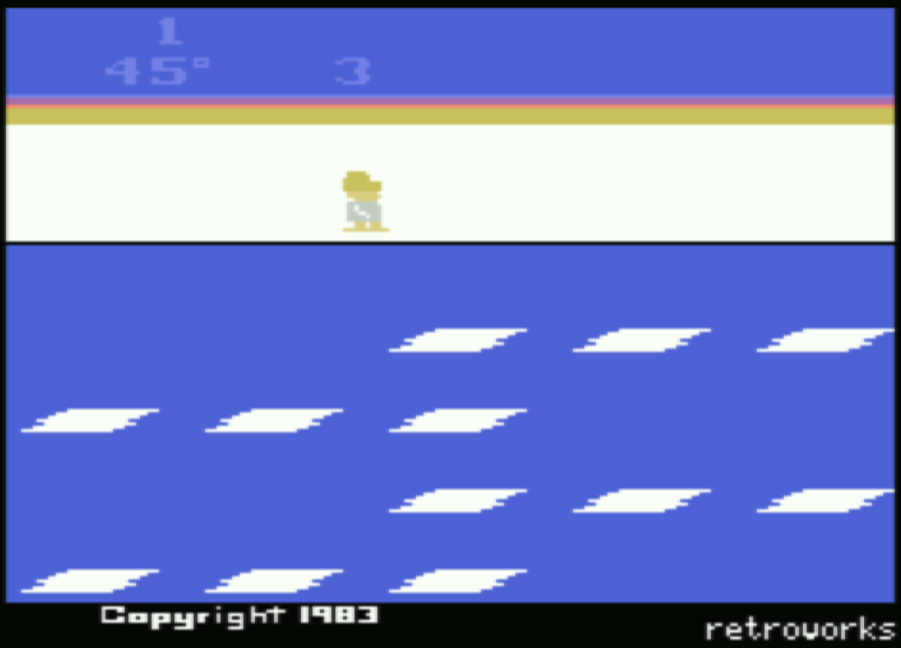

**Help bring more projects to the community.** This is a passion project with
no profit motive, no sponsors and no outside funding so far. Every piece of
equipment, all materials and every hour of development have been paid for or
contributed personally, without reimbursement.

Your contribution helps sustain Seaquest for MSX1 and makes room for new
projects, with the code always freely available to the community. More financial
support means more resources and time to build, test and share. If you enjoy
this work and want to see more of it, please consider buying me a coffee.
Every contribution helps keep these projects moving. Thank you for being part
of what comes next!

# Frostbite for MSX1

A native MSX1 port of Activision's Atari 2600 Frostbite, with Activision /
Retroworks credits and the supplied original ROM as the gameplay authority.

**[Download Frostbite 1.0.0](https://github.com/sandersouza/msxgp-frostbite/releases/tag/v1.0.0)** ·
**[Play in WebMSX](https://webmsx.org/?M=MSX1A&P=RAMNORMAL,NODISK&ROM=https%3A%2F%2Fgithub.com%2Fsandersouza%2Fmsxgp-frostbite%2Freleases%2Fdownload%2Fv1.0.0%2Ffrostbite-1.0.0.rom&ROM_FORMAT=Normal)**

## Play

Standard-speed **MSX1, 64 KiB RAM, 16 KiB VRAM**, TMS9918-family VDP and built-in
PSG. The complete 32 KiB **Normal cartridge** requires no mapper, disk, turbo
or additional hardware. Run the emulator at 100% speed.

- **F1:** start/reset. **F2:** select game; release between presses.
- **Arrow keys or joystick 1:** move/jump. **Space or fire:** action.
- **MSX-DOS:** run `FROSTBIT.COM` from a bootable DOS disk.
- **Disk BASIC:** keep `FROSTBIT.BAS`, `FROSTBIT.BIN` and `FBGFX.BIN` together;
  run `RUN"FROSTBIT.BAS"`.

Disk formats require their normal disk environment. After game takeover, use
machine RESET; returning to DOS/BASIC is not implemented.

Version 1.0.0 is the owner-approved stable release. Its original logic clock
and displayed-picture cadence are separate: measured presentation varies with
the route and video standard. Original 60-picture/s presentation and physical
hardware certification are not claimed. See the
[release baseline](docs/release-1.0.0.md) for exact hashes and evidence limits.

## Development

- [Build, validation and source layout](docs/development.md)
- [Host tools and setup](docs/toolchain.md)
- [Native cartridge and disk loaders](docs/native-formats.md)
- [Original gameplay contracts](docs/gameplay-contracts.md)
- [Delivery workflow](docs/project-workflow.md)

`make build`, `make run` and `make smoke` exercise the original-free hardware
diagnostic. They do **not** build or certify the released game. Native game
builds require the local, hash-qualified inputs described in the development
guide. Original ROMs, full disassemblies and derived generated assets remain
local and excluded from public CI.

Pre-1.0 plans, handoffs and superseded experiments are available in Git history
and the [v1.0.0 source tree](https://github.com/sandersouza/msxgp-frostbite/tree/v1.0.0).
Published releases retain their original binaries and metadata.

## Support

This is a community project funded by personal time and resources. Contributions
help sustain Frostbite for MSX1 and future ports, with the code freely available.

## License

[GPLv3](LICENSE). Original Atari/Activision material retains its ownership and
is not included in the public source. ZX0 notices are retained under
`src/third_party/zx0/`; inherited infrastructure provenance and local recovery
information are recorded in [baseline preservation](docs/baseline-preservation.md).
